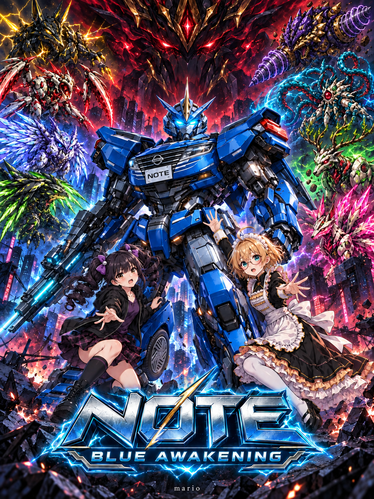

# NOTE — BLUE AWAKENING

青い機械の守護者NOTEが、失われた街の灯りを取り戻す横スクロールアクションゲームです。

**制作：mario**

## 遊ぶ

GitHub Pagesの公開設定が完了したら、下記URLでブラウザーから遊べます。

https://mario335599-boop.github.io/note-blue-awakening/

8つのステージと8体のボス、最後の戦い。ボス撃破で獲得した技は、ルナとノエルの研究所で通常技・チャージ技を自動実演します。全自動オープニング、エンディング、エンドロールも収録しています。

## 操作

| 操作 | キー |
| --- | --- |
| 移動 | ← → / A D |
| ジャンプ・壁蹴り | Z / Space |
| ダッシュ | C / Shift |
| 射撃・長押しチャージ | X / J |
| 武器切り替え | Q / E |
| Eタンク | F |
| 一時停止 | Esc |

ゲームパッドと画面上のタッチボタンにも対応しています。音声は最初に画面をクリックして有効にしてください。セーブはブラウザーに保存されます。

## ホーム画面に追加

ゲームの公開ページを開いて、ブラウザーの「ホーム画面に追加」を選ぶと、専用のNOTEロゴと名前で起動できます。iPhoneではSafariの共有メニューから追加してください。

## ローカルで起動

Pythonがある場合は、このフォルダーで `python3 -m http.server 8000` を実行して `http://localhost:8000/` を開きます。ビルドや外部ライブラリーは不要です。

## GitHub Pagesの設定

リポジトリの **Settings → Pages** で、Sourceを **Deploy from a branch**、Branchを **main**、フォルダーを **/(root)** にして保存します。

## 最新の更新

- バスターは0.45秒で1段階目、1.2秒で2段階目のチャージ。段階ごとに威力・大きさ・光・効果音が変化。
- 各アクションのドット絵の銃口位置から弾とマズルフラッシュを発生。壁での左右反転にも対応。
- ステージ別の床・壁・移動床・昇降床を36枚の新しいドット絵へ。接地面と横幅は画像の不透明部分から算出。
- ボス扉は9テーマ×閉鎖／開放の18画像。開口部に合わせて扉の位置と大きさを調整。
- HP回復、Eタンク、最大HPハートコアの新しいアイコンを追加。
- 途中通過ゲートは4状態の画像で未登録／スキャン／登録済み／成功発光を表示。通過するとHP回復と復帰地点登録。

- スマホ起動時に全画面・横画面を要求。向きの固定が使えないブラウザーではゲームの表示を横向きに回転。
- 半透明のアイコン式タッチ操作。左下に移動、右下は上に武器・左にバスター・右に加速・下にジャンプ。同時押しと長押しに対応。
- オープニング「BLUE RESOLVE」、ボス選択「TARGET GRID」、エンディング「A NEW DAWN」の専用BGMを追加。
- ボス入室演出中もバスターを押し続けるとチャージを維持。
- 通常バスターのチャージ弾の幅・高さを従来の1.5倍へ。8種の特殊チャージ攻撃を属性が分かる描画に変更。
- ザコ敵はNOTEと同程度のサイズ・判定へ。射撃の間隔を2倍に延長。
- 9ステージの地形を個別に再設計。ベルト、溶岩、プレス、昇降床、上昇気流、水流、崩れる足場、蔓、消える光床などを追加。

## 更新内容（v6）

- NOTEの物語用背面デザインと首の向きを修正。
- HPが尽きると、8コマの破壊アニメーション後にリトライ画面を表示。
- 全8種類の技を研究所で会話付きで自動実演。
- ボスごとの咆哮、目の発光、予告専用音楽。
- オリジナルの画像と音楽・効果音を収録。画像制作にはAI画像生成を使用。

## クレジット

企画・制作・デザイン・シナリオ・ゲーム開発・背景・音楽・演出：mario

SPECIAL THANKS：**mario**

このリポジトリにオープンソースライセンスは設定していません。
